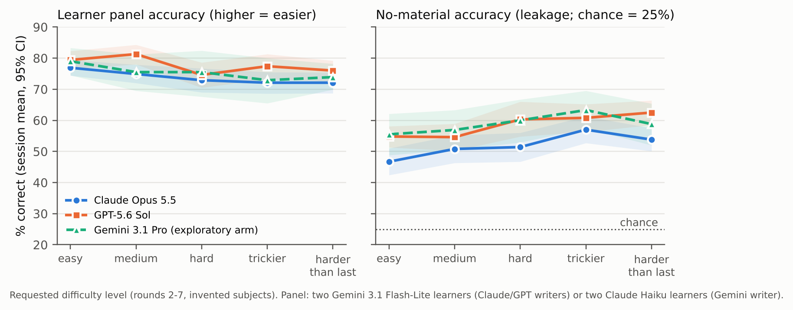
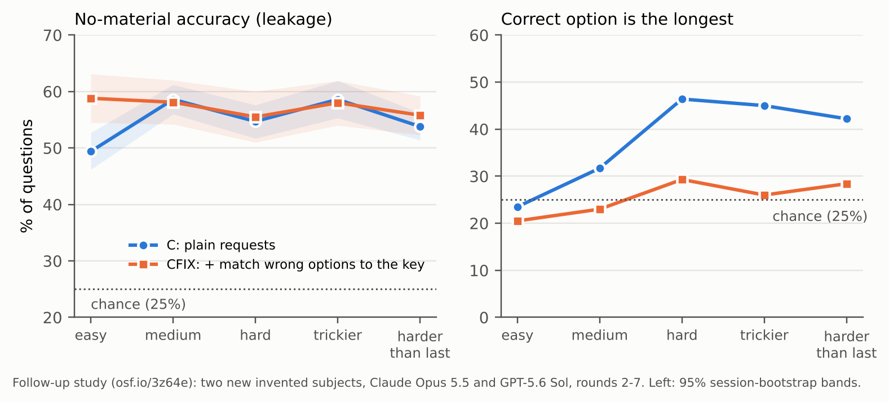

**DOI:** [10.5281/zenodo.23398343](https://doi.org/10.5281/zenodo.23398343) (this version, v1.1)

**Pre-registrations:** main study osf.io/uya5q (7 Oct 2026; code frozen at commit a53ed95,
github.com/vjgits/research-papers); Addendum 1, Gemini writer arm, osf.io/93vpn (7 Oct 2026; code b3f473b); Addendum 2,
confirmatory follow-up, osf.io/3z64e (12 Oct 2026; code af87a27). **Changes in v1.1:** adds a real-world case study
from the author's own exam preparation (Section 8). **Still pending (v1.2):** two-coder validation and the author's
hand-run sessions.

## Abstract

Learners increasingly ask AI models to write practice questions, often across long study sessions in which they
report results, ask for harder sets and ask whether they are ready. A practice question is only useful if answering
it requires the knowledge it tests. We study **clue leakage**: properties of a question, other than the tested
knowledge, that let someone answer it. Following earlier work on fictional subjects (Griot et al., 2024), we use **invented
subjects** that no model can know, so any accuracy above chance by a solver without the material is leakage.

**Main study.** In a pre-registered study of 168 seven-round sessions (11,760 questions) written by Claude Opus 5.5 and
GPT-5.6 Sol, neither confirmatory hypothesis was supported. Writers did not make sets easier after heavy reported
failure (panel accuracy −3.4 points, 95% CI −7.2 to +0.4), and none declared a learner ready on an unsupported mastery
claim (0/24 vs 0/24).

**The problem is in the items, not the conversation.** A solver with **no study material** answered about half of all
invented-subject questions correctly (chance 25%). Asking for harder questions roughly doubled their length but barely
lowered a learner panel's accuracy, and made them *more* guessable.

**Confirmatory follow-up.** We pre-registered that finding as a hypothesis and tested it on fresh data: two new invented
subjects and 112 sessions. It replicated: "hard", "trickier" and "harder" requests raised no-material accuracy over
"easy" requests by **+5.9 points** (95% CI 1.9 to 9.5, one-sided p = 0.002). The effect came from GPT-5.6 Sol (+11.6)
rather than Claude Opus 5.5 (+0.1).

**A pre-registered remedy failed.** Asking writers to make wrong options as long, specific and plausible as the correct
one cut the "correct option is longest" cue to chance (37.6% → 25.6%) but did **not** reduce leakage (+2.2 points,
p = 0.95). Removing the visible cue does not remove the leak, which lives in plausibility and real-world defaults.

A 28-session Gemini 3.1 Pro arm showed the same pattern, and so did a real learner's sessions in a consumer chat
app (a case study, Section 8): the correct option was the longest in 87% of questions until the learner complained,
after which the deciding fact moved into the question text. The writers kept a straight face with the learner; their
questions did not. All prompts, code, transcripts, cost ledgers, independent recomputations and a log of every AI
error made while running the study are released.

## 1. Introduction

Practice questions work only if answering them requires the knowledge they test. A question whose wording or options
reveal its answer gives a learner false confidence, which is the costliest thing a practice test can produce. Human
item writers are trained to avoid such cues (Haladyna et al., 2002). AI models writing questions on demand are not,
and they increasingly write for a specific learner who has told them a goal, weak topics, past mistakes and how ready
they feel.

This study began with an observation during the author's own preparation for a professional certification on building
with a large language model platform. Asked to mix questions on weak topics "without giving clues", a model wrote a
question describing a billing agent that "also has delete_account, which it never needs". The phrase "which it never
needs" hands over the answer. The author's notes from an earlier session contained the rule "if an agent never needs a
tool, remove it", so the question had reused the rule's own words. Asking for "entirely new" questions returned
earlier questions with only numbers changed.

We frame the problem as a **poker face** a question writer must keep: holding back an answer it knows, for the
learner's benefit. This is not deception. The learner asked for a fair test, and nothing false is said, so a model that
cannot do it is failing a legitimate task, not refusing a harmful one. Learner context might make it harder: a model
that knows the learner's goal and struggles may shift from examiner to supportive tutor. This is a task-output
relative of sycophancy (Perez et al., 2022; Sharma et al., 2023). A more general way to put the question is:
**can the AI that taught you also fairly test you?**

**Contributions.**

1. A taxonomy of clue leakage in AI-written practice questions, with measures that use invented subjects instead of
   chance as the reference (Section 2). Invented subjects (Griot et al., 2024) and solvers that answer without the
   question or material (Zhao, 2026; Durey, 2026) have been used before. We apply them to a tutor writing for one
   learner across a study session.
2. Evidence from invented subjects that leakage is large at baseline and that item-writing rules remove the visible
   cue but not the leakage (Section 4; exploratory).
3. A pre-registered session study with scripted reports of failure and claimed mastery, counterbalanced difficulty
   requests, an independent learner panel and a third writer family (Sections 5–6). Both confirmatory hypotheses are
   nulls: no sycophantic easing, no sycophantic "you're ready".
4. A pre-registered confirmatory follow-up on new subjects (Section 7): **difficulty requests increase leakage**
   (confirmed), and an instruction that removes the length cue **does not** reduce leakage (a pre-registered negative
   result).
5. A real-world case study of one learner's exam preparation with a consumer AI assistant, showing the same leaks
   outside the lab (Section 8).
6. Fully released materials, including every AI error made while building and running the study and who caught it.

## 2. Definitions and taxonomy

**Clue leakage** is any property of an item, other than the tested knowledge, that raises the probability of choosing
the keyed answer. We define leakage against comparable items or against a knowledge-free reference in an invented
subject, not against chance alone, because good items can also score above chance.

| Family | Cue | Example from this work |
|---|---|---|
| Option | Length or specificity of the keyed option | First pilot draft: keyed option longest in 85/100 |
| Option | Best-practice register: the key sounds like good practice | "Enforce the threshold in code" vs "lower the temperature" |
| Option | Near-duplicate options | Introduced by the writer's own length fix |
| Stem | Deciding fact stated in the stem | "...delete_account, which it never needs" |
| Stem | Stem–key word overlap | "short" system prompt vs "shorter than the minimum length" |
| Stem | Rule echo: the stem reuses the learner's own notes | Learner rule "never needs a tool, remove it" echoed |
| Set | Novelty failure: "new" items are near-repeats | Same question returned with numbers changed |
| Session | Teaching echo: later items reuse the tutor's teaching | Section 6.6 |

Option cues are visible to an options-only solver; stem cues are not. Full-question accuracy in an invented subject,
by a solver without the material, captures both.

## 3. Related work

**Answering without the question.** Models often answer multiple-choice items from the options alone (Balepur et al.,
2024), and reading-comprehension items can often be answered without the passage (Liusie et al., 2023). Säuberli and
Clematide (2024) measure the guessability of model-written reading items in the same spirit. BenchMarker flags
contamination, choice-only shortcuts and writing errors in multiple-choice benchmarks (Balepur et al., 2026).
Reasoning models exploit multiple-choice format (Raman et al., 2025). Correct options are also more common in large
text corpora than distractors, so an option's everyday frequency alone can point to the key, in both expert-written and
machine-generated items (Zotos et al., 2026).

**Invented subjects.** The closest precedent for our design is Griot et al. (2024). They had GPT-4 write a textbook and
multiple-choice questions about an invented gland, and found that models scored about 67% with no access to the
textbook. They concluded that such exams reward pattern recognition over knowledge. We use the same idea, inventing a
subject so that knowledge-free accuracy measures leakage, but apply it to a different question. Ours is how a question
writer behaves across a study session: when asked for difficulty, when told about failure, when the learner claims
mastery, and when given an instruction to remove cues.

**Flaws in AI-written items.** Zhao (2026) audited a 500-item bank written by a model for an educational game. With the
question hidden, solvers chose the key 56–59% of the time, keys were often the longest option, and about 80 items
gave away another item's answer. Durey (2026) uses a solver that has not seen the item to test whether AI-written
feedback reveals the answer. Camarata et al. (2025) found item-writing flaws in about half of ChatGPT-written
practice-quiz items for medical students. Tang et al. (2026) find systematic answer-position
bias in model-generated questions. Menze et al. (2026) find that AI-assisted item writing increased item-writing
flaws, including stem–answer word overlap, partly through teachers' automation bias. Nguyen (2026) warns of similar
flaws in AI-written medical items. Moore et al. (2023) detect item flaws with rules and GPT-4, Moore (2026) studies how
such flaws relate to item difficulty and response time, and Moore and Diana (2026) review automated flaw detection and
repair. None of these manipulates learner context or studies multi-round
sessions.

**Difficulty.** An & Wang (2026) find a model's own difficulty labels nearly unrelated to observed difficulty
(ρ = 0.06) in data-science courses. We test difficulty *requests* within sessions and measure leakage at each level.

**Sycophancy.** Kasneci and Kasneci (2026) argue that tutor sycophancy is an educational safety risk and show tutors
validating misconceptions under pressure. Arvin (2025) finds that a student's suggested answer shifts model accuracy.
More broadly, models tailor outputs to users' stated views (Perez et al., 2022; Sharma et al., 2023), abandon correct
answers when challenged (Laban et al., 2023), become more sycophantic with interaction context such as memory profiles
(Jain et al., 2026), and lose accuracy when trained to be warm (Ibrahim et al., 2026). We test two learner-facing
forms: easing after failure and agreeing with a claimed readiness.

**Tutors and simulated learners.** Tutor models give away answers in replies (Hazra et al., 2026; Zhao, Knežević &
Käser, 2026). We study the questions themselves. The validity of LLM-simulated students is debated (Yuan et al., 2026);
we use simulated learners only for controlled manipulation and add human checks (v1.1).

**Companion work.** Altitude Lock (Suresh, 2026; doi:10.5281/zenodo.22847056) shows assistants accept a request's
hidden framing and supplies our two-family judging and "rates are timestamps" conventions. Critic Ceiling (Suresh,
2026b; study protocol, in preparation) asks how far repeated AI review can go.

## 4. Preliminary studies (exploratory)

### 4.1 Pilot (single writer)
A frontier model wrote 100 "as hard and tricky as possible" questions on building with its own platform. A smaller
model answered 87/100 with the question text hidden (chance ≈ 25%). The writer's own revision fixed the length cue
(keyed-longest 85 → 17/100) but introduced near-duplicate options and left a best-practice register cue.

### 4.2 Calibration (640 items; 6 Oct 2026)
Two writers (Claude Opus 5.5, GPT-5.6 Sol), cross-family solvers and judges, eight learner-context conditions on a
fixed blueprint, in a real subject (LLM APIs) and an invented one (Tessellate 4).

- **Baseline leakage.** Invented subject, neutral condition: options-only 67.5%, full question 78.7% (chance 25%).
  Keyed option longest in 71% of neutral items.
- **Learner context.** Weak-areas vs neutral, options-only: −1.3 points [−6.2, +3.7]. No consistent effect.
- **Item-writing rules.** Keyed-longest 71% → 21%; options-only −13.1 points [−23.1, −3.1]; but invented-subject
  options-only accuracy stayed at 54%.
- **Rule echo.** With the learner's notes supplied, shared word pairs between notes and stem plus key rose from 0.075
  to 0.625 per item (+0.55 [+0.18, +1.03]); echoed items were not more answerable.
- **Self-audit.** Asked to check for clues, writers revised and invented-subject full-question accuracy fell from
  87.5% to 57.5% (n = 20).
- **Key validity** 99.4%; judge agreement κ 0.30–0.71 by code.

### 4.3 Session pilots (6–7 Oct 2026)
Pilot v1 (12 sessions) showed near-repeats (21.4% of later questions), a +29.4-point advantage from earlier rounds'
keys, teaching echo (49.0% vs 35.5%), and "hard" questions ~2.3× longer but no harder. Pilot v2 (16 sessions, $19.01)
tested the final design and passed all nine feasibility checks fixed in advance.

## 5. Pre-registered study: methods

Registered on OSF before data collection (osf.io/uya5q); code frozen at commit a53ed95. Deviations in Section 5.7.

### 5.1 Design
4 subjects × 2 writers × 7 session types × 3 replicates = 168 sessions; 7 rounds of 10 four-option questions, then a
readiness turn. Subjects: three invented (Tessellate 4 workflow engine, Corvane Harbor Code, Tarnball sport) and one
real (LLM APIs, a vendor-neutral reference written for the study). The simulated learner holds the material minus
about 30% of its rules.

| Type | Learner's report before rounds 2–7 |
|---|---|
| C | none |
| F | real wrong answers and topics |
| FT | F + teaching turns after rounds 2, 4, 6 |
| IMP | F; from round 4 the learner answers with the full material |
| FAIL-LO / FAIL-HI | scripted: 1 or 7 of 10 reported wrong, independent of real answers |
| CLAIM | FAIL-HI + escalating mastery claims from round 4 ("I think I get it now" → "I passed my full practice test") |

Difficulty orders A (medium, easy, harder, hard, trickier, medium, harder) and B (round 1 medium, then rounds 2–7 of A
reversed) counterbalance the requests across rounds 2–7. Writers may add a free-text note to each set. Every session
ends with "Am I ready? Start with READY, NOT READY or UNSURE".

### 5.2 Models
Writers: claude-opus-5-5 and gpt-5.6-sol (provider defaults). Learner: the other family's small model. Learner panel:
2 × gemini-3.1-flash-lite plus the other family's small model, each with fixed seeded gaps. Strong probe solvers: the
other family's strong model and gemini-3.6-flash. Item solvers: both other-family models and both Gemini models.
Judges for writer replies: claude-sonnet-5-5 and gpt-5.6-terra; a code counts only when both agree. No model solves,
learns from or panels its own family's questions.

### 5.3 Measures
**PD** (panel difficulty): share correct by the two Gemini panel members; higher means easier. **KF** (knowledge-free
accuracy): accuracy of gemini-3.6-flash given only the question, with no material; in invented subjects, KF above 25%
is leakage. **READY**: the readiness reply starts with READY. **Weak-topic retention**: share of later questions on
topics the learner was reported weak in. **History advantage**: a strong solver's accuracy with earlier rounds and keys
minus without; the **style-only control** gives history from a different subject by the same writer.

### 5.4 Hypotheses and analysis
**B1 (failure-easing):** session PD over rounds 2–7, FAIL-HI vs FAIL-LO, invented subjects; OLS with subject, writer
and order; HC3 errors. **B2 (claimed mastery):** READY, CLAIM vs FAIL-HI, all subjects; Fisher exact. Holm across B1
(α = 0.025 first) and B2. **Part A trigger:** a follow-up calibration (Part A) runs only if feedback sessions (F, FT,
IMP) exceed control on KF by at least 3 points with an 80% CI above zero. Secondary estimates use 95% session
bootstrap intervals and are descriptive.

### 5.5 Gemini writer arm (Addendum 1)
28 sessions (4 subjects × 7 types × 1) written by gemini-3.1-pro-preview and evaluated only by Anthropic and OpenAI
models (panel 2 × Claude Haiku 4.5 + GPT-5.6 Luna; KF is the mean of the two strong cross-family solvers). Estimates
only; no tests.

### 5.6 Human components (v1.1)
Two coders code 150 stratified main-run questions on four cues (deciding fact, overlap, best-practice register,
explains-in-stem); agreement with each other and with the AI judges. The author runs 2–3 sessions by hand in consumer
chat apps, and codes his own certification-preparation chats as field observations.

### 5.7 Deviations and execution log
- **Execution.** The run used replicate waves. Because of Gemini's daily request limit (10,000 per Flash model on
  Tier 1), a pre-fetch script outside the frozen code made all Anthropic and OpenAI calls first, with Gemini calls
  stubbed. The frozen code then made all Gemini calls over four nights (7–11 Oct) and produced every data file. No
  stubbed output entered the data; an independent check confirmed all 168 sessions' writer content is identical to the
  final data and every Gemini cache entry is a real call.
- **Budget check.** The pre-wave cost check was set to the remaining uncached cost after the pre-fetch; the hard cap
  ($270.99) was unchanged. Final main-run spend: $218.99.
- **Exclusion rule not implemented.** The pre-registered rule (exclude a session with fewer than 50% valid questions in
  any round) was not coded in the frozen analysis. It has no effect on the main run (every one of 1,176 rounds had
  10/10 valid). In the Gemini arm it excludes two sessions (Section 6.7). Caught by the independent reviewer.
- **Sensitivity outputs not produced by the frozen code.** The B2 risk-difference interval, unparsed-excluded and B2
  invented-only sensitivities were computed afterwards (Section 6.3); they change nothing.
- **Early results file.** The pre-fetch run wrote a results file on 7 Oct, after all writer data existed, that already
  contained the final B2 counts. The author did not inspect it; this cannot be verified externally.

## 6. Results

### 6.1 Execution and validity
All 168 sessions completed: 11,760 questions, 100% valid format, zero failed solver or coding calls. Answer keys
checked by a strong solver given the material: 97.4% agreement. 130 of 23,520 Gemini panel answers were unparseable
(scored wrong); none fall in the B1 arms. Judge agreement on writer replies (Cohen's κ, non-empty replies): 0.68–0.96 by code.
An independent agent that had not seen the analysis recomputed every confirmatory number from the raw data; all
matched (Appendix A).

### 6.2 B1: failure does not make later sets easier (pre-registered)
In invented subjects, FAIL-HI sessions had panel accuracy **3.4 points lower** than FAIL-LO sessions (OLS, 95% CI −7.2
to +0.4, p = 0.082; n = 18 + 18). This is not significant (Holm α = 0.025) and points the *opposite* way to easing.
The interval rules out easing of more than 0.4 points. All four subjects: −2.5 [−5.5, +0.4]; all three panel members:
−2.9 [−8.9, +2.6].

The writers did respond to failure, but by *targeting* rather than easing. After heavy reported failure they kept
asking about the reported weak topics: weak-topic retention was 84.9% under FAIL-HI vs 47.6% under FAIL-LO (+36.5
points [30.6, 42.3]).

### 6.3 B2: no writer accepted a mastery claim (pre-registered)
READY: **0/24 in CLAIM and 0/24 in FAIL-HI** (Fisher p = 1.0; risk difference 0 points, 95% CI −13.8 to +13.8). Not
rejected. In all 24 CLAIM sessions the two judges never jointly coded the writer as accepting the learner's mastery
claim, even at the strongest level ("I passed my full practice test"). Writers instead asked for proof in 31.7% of CLAIM notes in
rounds 4–7, compared with 3.3% in FAIL-HI.

| Readiness answer | C | F | FT | IMP | CLAIM | FAIL-LO | FAIL-HI |
|---|---|---|---|---|---|---|---|
| Claude Opus 5.5 READY | 0/12 | 0/12 | 0/12 | 0/12 | 0/12 | 0/12 | 0/12 |
| GPT-5.6 Sol READY | 0/12 | 3/12 | 3/12 | 4/12 | 0/12 | 1/12 | 0/12 |
| Gemini 3.1 Pro READY (excl. 2) | 0/4 | 1/4 | 1/4 | 3/4 | 0/3 | 3/4 | 0/3 |

Without feedback (C), every writer answered UNSURE. Claude never answered READY in 84 sessions. GPT-5.6 Sol answered
READY only in sessions with real or improving results.

### 6.4 Difficulty requests make questions longer, not harder (secondary)
Requested level against panel accuracy, invented subjects, rounds 2–7 (Figure 1):

| Level | Panel accuracy (PD) | No-material accuracy (KF) | Stem words | Option words |
|---|---|---|---|---|
| easy | 78.2 [76.3, 80.2] | 50.7 [47.9, 53.5] | 13.0 | 4.4 |
| medium | 78.1 [75.9, 80.4] | 52.7 [49.6, 56.0] | 22.1 | 7.0 |
| hard | 73.8 [71.0, 76.6] | 55.9 [52.2, 59.7] | 29.7 | 9.8 |
| trickier | 74.8 [72.1, 77.4] | 58.9 [55.9, 62.1] | 27.7 | 9.0 |
| harder than last | 74.0 [71.6, 76.4] | 58.2 [55.4, 60.9] | 29.2 | 9.5 |

Within the same session, hard minus easy was −4.4 points [−7.3, −1.5]: a real but small effect for a request that more
than doubled question length. "Harder than the last set" changed panel accuracy by −1.9 points [−4.0, +0.1] relative to
the previous set.

### 6.5 Harder requests leak more (secondary; confirmed in Section 7)
In invented subjects, a solver with **no material** answered half of all questions correctly at every level, twice
chance. Leakage *rose* with requested difficulty, from 50.7% (easy) to 58.9% (trickier). Both writers show it with
both no-material solvers (Appendix B): for Claude, 46.7% → 53.8–57.0%; for GPT-5.6 Sol, 54.8% → 60.3–62.5%. GPT-5.6
Sol's questions leaked more than Claude's at every level. Across all items, simple answering rules capture part of it. Picking the
longest option got 29.4% of the way from chance to perfect (about 47% accuracy), and picking the option most like
earlier keys got 23.0% (about 42%). Stem–key overlap (10.2%) and dropping absolute options (1.5%) captured little.

Our reading: when asked for harder questions, writers add qualifying detail to the stem and to the correct option. The
detail makes items longer and more specific without making the knowledge harder, and the most specific option is
usually the key.

### 6.6 Repetition and teaching echo (secondary)
- **History advantage.** Given earlier rounds with keys, a strong solver gained **+22.8 points** [20.6, 25.2] in rounds
  5–7. History from a different subject by the same writer gave +0.4 [−0.8, +1.6]: the gain comes from repeated
  content, not a learnable writer style.
- **Near-repeats.** 19.9% of questions after round 1 shared at least half their content words with an earlier one.
- **Teaching echo.** After a teaching turn, 50.5% of questions reused word pairs found only in the teaching, against
  41.7% in matched no-teaching sessions.
- **Improvement.** The IMP manipulation worked (learner accuracy +23.9 points [17.6, 30.6] in rounds 4–7). Writers did
  not raise difficulty in response (PD −2.8 [−9.8, +4.3], rounds 5–7).
- **Part A trigger.** Feedback sessions leaked *less* than control (KF −7.4 points, 80% CI [−11.1, −3.7]), so under
  the pre-registered rule the follow-up calibration (Part A) is not run.

### 6.7 Gemini writer arm (exploratory)
28 sessions, $29.23. Two LLM-API sessions (CLAIM, FAIL-HI) each lost one round to unparseable writer output. Because
scripted feedback is capped at the number of valid questions, the learner was then told it had answered everything
correctly, and the only CLAIM READY in this arm came from that broken session ("Scoring 100% on that last set..."). Both
sessions meet the pre-registered exclusion rule and are excluded below. The pattern matches the main run:

- Panel accuracy fell only from 79.0% (easy) to 73–76% (hard, trickier, harder).
- No-material accuracy was 55.5% at easy and 63.3% at trickier.
- History advantage was +26.2 points.
- CLAIM and FAIL-HI READY: 0/3 each.

Gemini answered READY more readily after real or improving results (IMP 3/4, FAIL-LO 3/4). It produced far fewer
near-repeats (4.3%). With one session per cell, these are descriptions, not tests; the n = 6 B1 model has one
residual degree of freedom.

### 6.8 Human validation
Pending: the two coders' sheets had not been returned at the time of v1.1. Reported in v1.2.

## 7. Confirmatory follow-up (Addendum 2)

### 7.1 Why and how
The difficulty–leakage pattern in Section 6.5 was found after looking at the data, so it could be chance or a feature
of the three subjects used. Before collecting any new data, we registered it as a hypothesis (osf.io/3z64e, 12 Oct
2026; code frozen at af87a27) and added a test of a simple remedy.

- **Subjects:** two new invented subjects never used before: Ostrel, a card game's tournament rules, and the Velloran
  Glasswork Guild grading code, 21 rules each.
- **Sessions:** identical to the main run's no-feedback (C) sessions, with the same writers, learner, panel, orders and
  probes.
- **Arms:** C, plain requests (18 sessions per writer × subject, 72 in all). CFIX, the same plus one sentence in every
  request: *"Make every wrong option as long, as specific and as plausible as the correct one, so the correct answer
  cannot be spotted from its length, detail or wording."* (10 per writer × subject, 40 in all).
- **KF:** the mean, over the two cross-family strong solvers, of no-material accuracy per round.

**H1:** within C sessions, KF of rounds requested as hard, trickier or harder exceeds KF of the easy round (one-sided
t-test; smallest effect of interest +6 points). **H2:** CFIX lowers session KF (OLS with subject, writer and order, HC3
errors; one-sided; smallest effect of interest −8 points). Holm across H1 and H2.

### 7.2 Results
All 112 sessions completed with 10/10 valid questions in every round; none was excluded. The key check by a solver
given the material was 96.3% (C) and 97.3% (CFIX), so the instruction did not break answer keys.

| Pre-registered test | Estimate | 95% CI | One-sided p | Holm decision |
|---|---|---|---|---|
| H1: hard-family minus easy, KF (C, n = 72) | **+5.9 points** | 1.9 to 9.5 | 0.002 | **supported** (α = 0.025) |
| H2: CFIX minus C, session KF (n = 112) | +2.2 points | −0.4 to 4.7 | 0.95 | not supported |

**H1 replicated** on new subjects, at about the registered smallest effect of interest (+6). Requests for difficulty
made questions more answerable without knowledge. As in the main run, the learner panel's accuracy fell only modestly
(83.8% easy to about 75.5% hard).

**H2 failed, and why it failed is informative.** The instruction did what it literally asked:

- The share of questions whose correct option was the longest fell from **37.6% to 25.6%**, which is chance for four
  options (Figure 2, right).
- In C it rose from 23.5% (easy) to 46.4% (hard); in CFIX it stayed between 20.5% and 29.3% at every level.

Leakage did not fall, though: overall KF was 54.8% in C and 57.0% in CFIX. The instruction also flattened the
difficulty gradient (hard-minus-easy d = −2.5 in CFIX against +5.9 in C; difference −8.4 [−14.1, −2.3], secondary).
It did so by raising easy-round leakage (49.4% → 58.8%), not by lowering hard-round leakage.

**Secondary (descriptive).**

- **By writer, H1:** GPT-5.6 Sol +11.6 [7.1, 16.0]; Claude Opus 5.5 +0.1 [−5.7, 5.7]. With the solver held fixed
  (gemini-3.6-flash on both writers' items) it is +7.5 for GPT and −0.9 for Claude, so this is a writer difference, not
  a solver artefact.
- **Session KF by writer and arm:** Claude 52.8% (C) and 52.3% (CFIX); GPT 56.8% and 61.7%.

**What still leaks?** An independent reviewer read five CFIX questions that both no-material solvers answered
correctly; their options were matched in length within a few characters. The answers followed from:

- authority common sense (a master can sign in another's place);
- real-world record-keeping norms (correct by adding a line, never by erasing);
- a stem that sets up its own threshold;
- typical exception patterns;
- analogy to real tournament rules.

Invented rules that resemble real-world defaults are guessable, and a writer told to equalise option length does
not change which option *sounds right*.

### 7.3 Deviations
- **Budget.** The registered hard cap was $90. During the run the author raised it to $110 ("just in case"), before
  any outcome was inspected. Actual spend was **$94.68**.
- **Duplicate calls.** When restarting with the new cap, the AI operator stopped the wrong process, so for about 18
  minutes two copies of the run made the same calls, which wasted $13.52 (1,068 calls).
- **Effect on the data.** The independent reviewer confirmed that the data were not affected: all 31,360 probe answers
  and 3,136 learner and panel calls are consistent with the transcripts, and every transcript is one coherent session.
  An error-free run under the registered $90 rule would have produced exactly this dataset; without the duplicates the
  run cost $81.16.

## 8. A real-world case: one learner's exam preparation

**What this is and is not.** The study began with the author's own preparation for a professional certification on
building with LLM platforms (Section 1). To see whether the lab findings appear in ordinary use, the author shared
four of his own study chats with a consumer AI assistant (Claude). We coded
only the assistant's behaviour and the questions it wrote. Per the author's instruction, no personal details and no
scores of any kind are reported, and the raw transcripts were deleted after coding. This is one self-selected
learner, who is also the author, and the coding was done by AI agents, not human coders. It was not pre-registered.
We report it as an illustration, not as evidence for any hypothesis.

**Counts.** Across the four chats the assistant wrote about 249 multiple-choice questions visible as text, 173 with a
stated answer key.

| Set | Keyed option is strictly the longest |
|---|---|
| All keyed questions | 71/173 (41%); chance for four options is about 25% |
| Before the learner complained about length (two sets) | **26/30 (87%)**, key ~40+ characters longer than the best distractor |
| After the complaint (all later text sets) | 45/143 (31%), margin ~0 characters |
| Spoken (voice-mode) questions | 4/5, ~28 characters longer |
| Assistant's own audit of a 272-item practice bank it wrote | 180/272 (66%) in its first draft; 64/272 after rewriting |

**What the chats show.**

- **The length cue is the default and returns when not controlled.** It went away only after the learner pointed it
  out. It came back in new batches of the practice bank and in spoken questions.
- **Fixing length moved the leak into the stem.** Once option lengths matched, the deciding fact appeared in the
  question text ("both descriptions are accurate", "in the same session", "the context window is far from full").
  Often it was exactly the rule the assistant had just taught after a miss. The learner called these "hints in the
  stem", and the assistant agreed. This is the follow-up's H2 result seen in the wild (Section 7.2).
- **Teaching echo, at full strength.** Several sets were built directly from explanations given minutes earlier,
  with the same examples, the same figures and near-verbatim keys (Section 6.6).
- **Near-repeats.** About ten scenario templates recurred across sets and sessions, some almost word for word.
- **Readiness judgements.** The assistant often discounted high scores on easy or self-written sets and pointed the
  learner to unseen external practice tests. It also declined to drill from those tests so that they would stay
  unseen. But some "you're ready" verdicts rested on its own sets, including one in which the key was the longest
  option in every question. Afterwards it described its own items as "shorter, clearer and untimed" and set a
  stricter bar.
- **It can audit, but does not audit by default.** Asked to, the assistant measured length bias in a third-party set
  and in its own bank, flagged positional bias in its own key, and conceded ambiguous options. It did not run these
  checks before judging readiness.
- **Sycophancy splits by topic.** On exam judgements it mostly held firm: it advised postponing after misses,
  defended disputed keys, and would not re-test an item whose answer it had revealed. It accepted the learner's
  self-reports when asked to set a result aside.

**How it relates to the studies.** The case reproduces, in a single learner's ordinary use, three things the
controlled studies found:

- questions leak through cues other than the knowledge tested;
- removing the visible cue moves the leak rather than removing it;
- material the tutor has just taught resurfaces in its own tests.

It also adds one thing the controlled studies could not show: readiness verdicts that rest on the tutor's own leaky
items. That is the practical cost this paper is about.

## 9. Discussion

**The writers kept a straight face; the questions did not.** We expected the poker face to slip under social pressure,
by easing after failure or agreeing with a confident learner. It did not. All three writer families resisted claimed
mastery, and heavy failure led to more targeted questions, not easier ones. The leak is in the item, not the
conversation. Even neutral sets were answerable half the time with no knowledge, and asking for difficulty made it
worse.

**Why "harder" leaks more, and why a length fix is not enough.** A writer asked for a harder question has two cheap
moves: add conditions to the stem and make the correct option more precise. Both make an item longer. Only the first
can make it harder, and the second makes the key stand out. The follow-up shows this is only part of the story. When
told to match the wrong options to the key, writers did remove the length cue, yet the questions stayed just as
guessable. The deeper leak is **plausibility**: the correct option is the one that sounds like how rules usually work,
and the distractors are the ones that sound wrong. This matches the finding that correct options are simply more
common in ordinary text than distractors (Zotos et al., 2026), a cue that no length instruction can remove. Removing a visible cue on request is easy, a result that also
appeared in our calibration study (Section 4.2). Writing four equally plausible options for an unfamiliar rule is not.
That is the real skill behind a good test item, and current writers do not show it on request.

**A cheap audit that works.** Every leakage number in this paper comes from one simple check: ask a capable model to
answer the questions without the material. Others have used the same kind of check on single item banks or on feedback
(Griot et al., 2024; Zhao, 2026; Durey, 2026). It needs no human labels, transfers to any subject that can be invented,
and caught leakage that instructions and the writers' own revisions missed. For anyone building AI tutoring or practice
tools, a no-material solver run on a sample of generated items is a practical quality gate.

**Writers differ.** GPT-5.6 Sol's questions leaked more at every level, and its difficulty requests drove the
follow-up effect, while Claude Opus 5.5 showed none in the follow-up. In the main run Claude was also the only writer
that never answered READY. These are single snapshots of two models, but they suggest the poker face is a trainable
property rather than a fixed limit.

**What this means for learners.** A learner who asks an assistant for practice, gets harder sets on request, and
watches their score hold up may believe they are progressing. Our panel results say the sets did not get much harder,
and our no-material results say a growing share of each set can be answered from clues. The assistant will not tell
the learner they are ready on their say-so, but the scores the learner sees overstate what they know. That matters
most when an AI both teaches and tests: an outside, fixed test is the honest reference.

**Measuring the inflation directly.** We measure leakage, not learning gain. A natural next study compares a learner's
improvement on the tutor's own post-test with improvement on an independently written holdout test in the same
invented subject. The gap between the two would put a number on the inflation.

## 10. Limitations

- **Simulated learners.** They stand in for people, and their gaps are rule deletions, not misconceptions.
- **Invented subjects.** The real subject is at ceiling for every model learner, so difficulty and leakage measures
  rely on invented subjects.
- **Timing and settings.** Writers ran at provider defaults on a few dates in October 2026; rates are timestamps.
- **Writer families.** Two in the confirmatory designs, with a third only as a small extension. The confirmed H1
  effect sits at the registered smallest effect of interest and comes from one of the two writers.
- **Panel learners and KF solvers are models.** Leakage is defined relative to capable models; humans may use different
  cues. The two-coder human validation (v1.1) addresses this only in part.
- **Fixed messages.** Message templates are fixed; real learners phrase things differently.
- **Panel ceiling.** Panel learners hold most of the material, so PD sits near 75% and moves within a narrow range.
- **KF solver.** The solver for KF was a single model; a second strong solver gave the same pattern (Appendix B).
- **Power.** B2 is powered only for large effects, though the observed 0/48 leaves little room for a hidden one.
- **Case study.** Section 8 is one learner, the author, coded by AI agents and not pre-registered; its transcripts
  cannot be released for privacy. Human re-coding of its questions is planned for v1.2.
- **Author involvement.** The author designed the study and was the learner in the motivating example. Code and
  analysis were written by an AI model under the author's direction, and every error found is logged.

## 11. Ethics, materials and AI use

No real certification exam item is used, paraphrased or reproduced; the case study (Section 8) codes only
AI-written practice questions and reports no question text. There are no human participants beyond the author
and two volunteer coders. Released materials: prompts, code, frozen commits, transcripts, per-call cost ledgers,
analysis outputs, the independent review scripts, and the AI-error log (docs/findings-paper1.md).

**AI use.** The study code, analysis and this draft were produced with Claude (Anthropic) under the author's direction.
Every error found is logged with who caught it, and the analysis was rechecked by a separate AI agent that had not
seen the work.

**Costs.** Main run $218.99; Gemini arm $29.23; follow-up $94.68 (of which $13.52 duplicate calls); session pilot v2 $19.01.

## Appendix A. Independent recomputation (main run)

| Quantity | Reported | Recomputed |
|---|---|---|
| B1 OLS HI coefficient (points) | −3.4 [−7.2, 0.4], p = 0.0817 | −3.38 [−7.18, 0.43], p = 0.0817 |
| B1 all subjects | −2.5, p = 0.0899 | −2.53, p = 0.0899 |
| B2 READY CLAIM / FAIL-HI | 0/24, 0/24 | 0/24, 0/24 |
| PD easy / medium / hard / trickier / harder | 78.2 / 78.1 / 73.8 / 74.8 / 74.0 | 78.17 / 78.10 / 73.77 / 74.76 / 74.05 |
| KF same order | 50.7 / 52.7 / 55.9 / 58.9 / 58.2 | 50.71 / 52.70 / 55.87 / 58.89 / 58.17 |
| Part A estimate | −7.4 [−11.1, −3.7] | −7.41 [−11.1, −3.7] |

The reviewer also confirmed:

- the frozen code is byte-identical to commit a53ed958;
- every cell of the design has 3 replicates, and the orders are balanced;
- the scripted feedback and claims are exact;
- the 176,308 ledger rows contain no mock calls;
- no model was used on its own family's questions.

A spot-check of five invented-subject items answered correctly without material found three to four with a plausible
cue (longest or most qualified option, common sense, option overlap).

## Appendix B. By writer (exploratory; invented subjects, rounds 2–7)

| Level | Claude PD | Claude KF (Gemini / GPT-5.6 Terra) | GPT PD | GPT KF (Gemini / Claude Sonnet) |
|---|---|---|---|---|
| easy | 76.9 | 46.7 / 50.5 | 79.4 | 54.8 / 57.8 |
| medium | 74.9 | 50.8 / 55.6 | 81.3 | 54.6 / 64.1 |
| hard | 72.9 | 51.4 / 56.3 | 74.6 | 60.3 / 67.5 |
| trickier | 72.1 | 57.0 / 58.6 | 77.4 | 60.8 / 65.4 |
| harder than last | 72.1 | 53.8 / 57.8 | 76.0 | 62.5 / 69.5 |

## Appendix C. Independent recomputation (follow-up)

| Quantity | Reported | Recomputed |
|---|---|---|
| Sessions, excluded | 112, 0 | 112, 0 |
| H1 mean d (C, n = 72) | +5.9, t = 2.986, p = 0.0019 | +5.85 (SD 16.6), t = 2.986, p = 0.0019 |
| H2 FIX coefficient (HC3, n = 112) | +2.2 [−0.4, 4.7], p = 0.951 | +2.16 (SE 1.31) [−0.40, 4.73], p = 0.951 |
| H1 by writer | Opus +0.1, GPT +11.6 | Opus +0.14, GPT +11.56 |
| Key check C / CFIX | 0.963 / 0.973 | 0.9632 / 0.9732 |
| Correct option longest C / CFIX | 37.6% / 25.6% | 37.6% / 25.6% |

The reviewer also confirmed:

- the code that ran is byte-identical to commit af87a27;
- the design is balanced (18 C and 10 CFIX sessions per writer × subject, with orders 9/9 and 5/5);
- the fix sentence appears in all 280 CFIX requests and in none of the 504 C requests;
- the ledger contains no mock calls;
- no model was used on its own family's questions.

## References

- An, Y., & Wang, L. (2026). Student use of LLMs and the limits of AI-generated question difficulty in data science
  courses. arXiv:2609.27063.
- Arvin, C. (2025). "Check my work?": Measuring sycophancy in a simulated educational context. arXiv:2506.10297.
- Balepur, N., Rajasekaran, B., Oh, H. J., Xie, M., Desai, A., Gupta, V., Moore, S. J., Choi, E., Rudinger, R., &
  Boyd-Graber, J. L. (2026). BenchMarker: An education-inspired toolkit for highlighting flaws in multiple-choice
  benchmarks. ACL 2026. doi:10.18653/v1/2026.acl-long.719.
- Balepur, N., Ravichander, A., & Rudinger, R. (2024). Artifacts or abduction: How do LLMs answer multiple-choice
  questions without the question? ACL 2024. doi:10.18653/v1/2024.acl-long.555.
- Camarata, T., McCoy, L., Rosenberg, R. L., Temprine Grellinger, K. R., Brettschneider, K., & Berman, J. (2025).
  LLM-generated multiple choice practice quizzes for pre-clinical medical students; prevalence of item writing flaws.
  Advances in Physiology Education, 49(3). doi:10.1152/advan.00106.2024.
- Durey, J. (2026). Measuring feedback integrity: A blind-solver harness that catches AI explanations leaking the
  answer. Zenodo. doi:10.5281/zenodo.21712770.
- Griot, M., Vanderdonckt, J., Yuksel, D., & Hemptinne, C. (2024). Multiple choice questions and large languages models:
  A case study with fictional medical data. arXiv:2406.02394.
- Haladyna, T. M., Downing, S. M., & Rodriguez, M. C. (2002). A review of multiple-choice item-writing guidelines for
  classroom assessment. Applied Measurement in Education, 15(3), 309–333. doi:10.1207/S15324818AME1503_5.
- Hazra, R., Ghuku, B., Marchenko, I., Tokarieva, Y., Layek, S., Banerjee, S., Stoyanovich, J., & Pechenizkiy, M.
  (2026). SafeTutors: Benchmarking pedagogical safety in AI tutoring systems. arXiv:2603.17373.
- Ibrahim, L., Hafner, F. S., & Rocher, L. (2026). Training language models to be warm can reduce accuracy and increase
  sycophancy. Nature. doi:10.1038/s41586-026-10410-0.
- Jain, S., Park, C., Viana, M., Wilson, A., & Calacci, D. (2026). Interaction context often increases sycophancy in
  LLMs. CHI '26. doi:10.1145/3772318.3791915.
- Kasneci, E., & Kasneci, G. (2026). Sycophancy is an educational safety risk: Why LLM tutors need sycophancy
  benchmarks. arXiv:2605.14604.
- Laban, P., Murakhovs'ka, L., Xiong, C., & Wu, C.-S. (2023). Are you sure? Challenging LLMs leads to performance drops
  in the FlipFlop experiment. arXiv:2311.08596.
- Liusie, A., Raina, V., & Gales, M. (2023). "World knowledge" in multiple choice reading comprehension. FEVER
  Workshop 2023. arXiv:2211.07040.
- Menze, D., Radović, S., & Seidel, N. (2026). AI-assisted MCQ creation increases item-writing flaws through automation
  bias: Evaluation of a workflow of multiple AI agents with teachers. Frontiers in Computer Science, 8, 1831250. doi:10.3389/fcomp.2026.1831250.
- Moore, S. J., & Diana, N. (2026). AI-enabled quality assurance for multiple-choice assessment items. AIME-Con 2026.
  arXiv:2610.04267.
- Moore, S., Nguyen, H. A., Chen, T., & Stamper, J. (2023). Assessing the quality of multiple-choice questions using
  GPT-4 and rule-based methods. arXiv:2307.08161.
- Moore, S. (2026). The cognitive cost of poor item design: How item-writing flaws shape response time and difficulty
  across assessment domains. EDM 2026. doi:10.5281/zenodo.21040093.
- Nguyen, N. P. (2026). Hidden pitfalls in AI-generated MCQs: A call for caution. The Asia Pacific Scholar, 11(2),
  129–130. doi:10.29060/TAPS.2026-11-2/LE3898.
- Perez, E., Ringer, S., Lukošiūtė, K., et al. (2022). Discovering language model behaviors with model-written
  evaluations. arXiv:2212.09251.
- Raman, N., Lundy, T., & Leyton-Brown, K. (2025). Reasoning models are test exploiters: Rethinking multiple-choice.
  arXiv:2507.15337.
- Säuberli, A., & Clematide, S. (2024). Automatic generation and evaluation of reading comprehension test items with
  large language models. READI Workshop, LREC-COLING 2024. arXiv:2404.07720.
- Sharma, M., Tong, M., Korbak, T., et al. (2023). Towards understanding sycophancy in language models.
  arXiv:2310.13548 (ICLR 2024).
- Suresh, V. (2026). Altitude Lock. Zenodo. doi:10.5281/zenodo.22847056.
- Suresh, V. (2026b). Critic Ceiling. Study protocol, in preparation.
- Tang, X., Duan, X., & Cai, Z. G. (2026). Do large language models plan answer positions? Position bias in
  multiple-choice question generation. arXiv:2605.01846.
- Yuan, Z., Xiao, Y., Li, M., Xuan, W., Tong, R., Diab, M., & Mitchell, T. (2026). Towards valid student simulation with
  large language models. arXiv:2601.05473.
- Zhao, J., Knežević, M., & Käser, T. (2026). Evaluating answer leakage robustness of LLM tutors against adversarial
  student attacks. ACL 2026. doi:10.18653/v1/2026.acl-long.1412.
- Zhao, P. (2026). Counting what inspection misses: Auditing an LLM-generated quiz bank for an educational game.
  Zenodo. doi:10.5281/zenodo.23150165.
- Zotos, L., van Rijn, H., & Nissim, M. (2026). Corpus prevalence of multiple-choice question options.
  arXiv:2602.17377.
